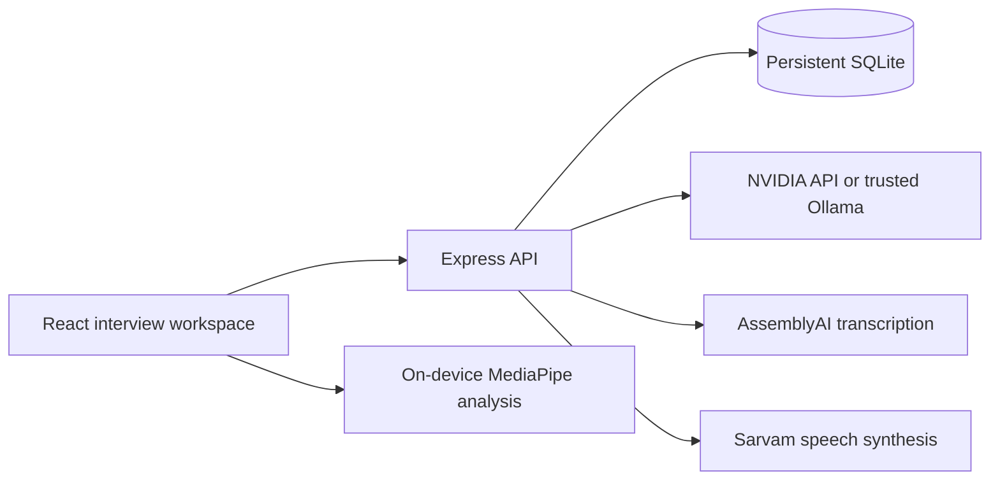

# InterviewAce

[](https://github.com/solmyst/AI-Powered-Interview-Coaching/actions/workflows/deploy.yml)

**Practice interviews aloud. Understand your feedback. Try again with purpose.**

InterviewAce is a voice-first AI interview coaching application for students and job seekers. Maya, the AI interviewer, asks questions aloud, listens to spoken answers, and generates adaptive follow-ups. After the interview, an evidence-based report and the spoken **Answer Lab** turn feedback into focused practice.

[Open the Azure pilot](https://interviewace-anush.indiasouthcentral.cloudapp.azure.com) · [Deployment guide](DEPLOYMENT.md) · [Answer Lab](docs/ANSWER-LAB.md) · [Roadmap](docs/ROADMAP.md)

This repository contains the full React application and Node API. It is a working coaching pilot; university administration, recruiter screening, ATS integrations, and billing are not implemented.

## Interview experience

1. **Set your context.** Choose a role, experience level, round, difficulty, industry, and 3–8 questions. Optionally add a target company, resume/project highlights, and job description.
2. **Check devices before joining.** Grant camera and microphone access, confirm the preview, and join the call.
3. **Answer aloud.** Maya speaks automatically; microphone capture begins after interviewer playback. Silence ends an answer, with a **Done speaking** control for noisy environments.
4. **Stay in control.** Pause/resume, repeat or clarify a question, toggle the camera, and use the fullscreen call view. Saved progress supports reload and recovery.
5. **Review your briefing.** Finish the interview and see report-generation progress, per-answer feedback, strengths, gaps, example answers, and a study plan.
6. **Practice in Answer Lab.** Choose an answer, review three checkpoints, retry aloud, and tackle a changed scenario. Compare transcript evidence while keeping the original interview scores intact.

Supported rounds: **Technical, Coding, System design, Behavioral, Product sense, and Aptitude**. Roles include software engineering, frontend, backend, full-stack, data science, AI/ML, DevOps, cybersecurity, product management, and HR. Coding feedback is conversational review; submitted code is not executed.

## Features

| Area                    | Available today                                                                                                                                         |
| ----------------------- | ------------------------------------------------------------------------------------------------------------------------------------------------------- |
| Realistic call flow     | Pre-join permissions, camera preview, automatic TTS/STT turns, fullscreen, pause/repeat/clarify, and completion briefing                                |
| Personalized interviews | Resume/job-description context, role and difficulty selection, adaptive follow-ups, and recent report weaknesses informing new sessions                 |
| Answer assessment       | Eight equally weighted dimensions: correctness, depth, clarity, structure, relevance, reasoning, evidence, and practicality                             |
| Answer Lab              | Spoken retry and transfer practice, fixed checkpoints, exact transcript-quote checks, and persisted comparisons                                         |
| Camera coaching         | On-device face/pose analysis, framing, approximate lens direction, alignment, and a separate delivery report                                            |
| Learning history        | Dashboard, saved interviews, practice-score timeline, bookmarks, revision library, and study plans                                                      |
| Account controls        | Email/password sign-in, profile edits, JSON export, interview deletion, and account deletion                                                            |
| Reliability             | Durable usage caps, request locking, idempotent starts, duplicate-answer protection, recoverable provider/network errors, and device reconnect controls |

Camera observations are approximate delivery signals. Confidence is self-reported; the app does not infer confidence, personality, or emotion from facial appearance. AI scores are coaching estimates, not validated hiring or admissions decisions.

## Current AI stack

The Azure pilot is configured with:

| Task                                                 | Provider                | Model / voice                                    |
| ---------------------------------------------------- | ----------------------- | ------------------------------------------------ |
| Questions, answer evaluations, reports, and coaching | NVIDIA hosted inference | `nvidia/nemotron-3.5-lightning-30b-a3b`          |
| Spoken-answer transcription                          | AssemblyAI              | `universal-3-5-pro`                              |
| Interviewer speech                                   | Sarvam                  | `bulbul:v4-flash` / `simran_enhi_customer`       |
| Optional local text generation                       | Ollama                  | Default: `qwen2.5:7b-instruct`                   |
| Camera presence analysis                             | MediaPipe Tasks Vision  | Face and pose landmarks processed in the browser |

English and Hindi speech paths are supported. Sarvam receives `hi-IN` when text contains Devanagari, otherwise `en-IN`; this is script detection, not a general language classifier. Browser speech synthesis is the fallback when cloud TTS is unavailable.

The Azure VM hosts the application and database. NVIDIA, AssemblyAI, and Sarvam are hosted APIs; their models do not run locally on that VM. Browser Whisper and ElevenLabs are not used by the active application. Historical prototype modules remain in `legacy/` and are excluded from the active bundle.

## Run locally

### 1. Install

Use **Node.js 24 LTS** and npm. The declared minimum Node version is 22.13.

```sh
git clone https://github.com/solmyst/AI-Powered-Interview-Coaching.git
cd AI-Powered-Interview-Coaching
npm ci
cp .env.example .env
npm run setup:vision
```

Vision setup copies the installed MediaPipe WASM runtime and downloads face/pose model assets into `public/vision/`. These generated files are not committed.

### 2. Configure providers

For the hosted stack, edit `.env`:

```dotenv
AI_PROVIDER=nvidia
NVIDIA_API_KEY=your_nvidia_key
NVIDIA_MODEL=nvidia/nemotron-3.5-lightning-30b-a3b

ASSEMBLYAI_API_KEY=your_assemblyai_key
ASSEMBLYAI_MODEL=universal-3-5-pro

SARVAM_API_KEY=your_sarvam_key
SARVAM_MODEL=bulbul:v4-flash
SARVAM_VOICE=simran_enhi_customer
```

Use credentials and model access available to your accounts. AssemblyAI is required for spoken answers. Sarvam is optional if browser TTS is sufficient. V4 Flash requires a compatible persona ID; old v3 names such as `priya` are not valid v4 voices.

To run the **text model locally**, use this alternative configuration:

```dotenv
AI_PROVIDER=ollama
OLLAMA_URL=http://127.0.0.1:11434
OLLAMA_MODEL=qwen2.5:7b-instruct
```

Start Ollama and install its model:

```sh
# Terminal 1; omit this if Ollama is already running
ollama serve

# Terminal 2
ollama pull qwen2.5:7b-instruct
```

This removes the NVIDIA requirement; speech transcription still uses AssemblyAI, and configured cloud TTS still uses Sarvam.

### 3. Start the app

```sh
npm run dev
```

Open **http://localhost:5173**, create an account, and start an interview. Use that exact origin rather than `127.0.0.1`: API mutations validate `APP_ORIGIN`.

Vite proxies `/api` to the Node server on loopback port 3001. SQLite is created under `data/`. Restart the API after changing provider settings. Keep `.env` private, never prefix provider keys with `VITE_`, and do not set `NODE_ENV=development` in `.env`; production builds must not bundle development React code.

## Configuration reference

| Variable                | Default / purpose                                                                 |
| ----------------------- | --------------------------------------------------------------------------------- |
| `PORT`                  | `3001`; API and production static server                                          |
| `HOST`                  | `127.0.0.1`; keep the API private behind the reverse proxy                        |
| `APP_ORIGIN`            | `http://localhost:5173`; exact HTTPS origin in production, without trailing slash |
| `DATABASE_PATH`         | `./data/interviewace.db`; use persistent storage in production                    |
| `AI_PROVIDER`           | `ollama` or `nvidia`; template defaults to Ollama                                 |
| `OLLAMA_URL`            | `http://127.0.0.1:11434`; trusted Ollama endpoint                                 |
| `OLLAMA_MODEL`          | `qwen2.5:7b-instruct`                                                             |
| `NVIDIA_API_KEY`        | Server-only NVIDIA credential                                                     |
| `NVIDIA_MODEL`          | Exact model ID enabled for the NVIDIA account                                     |
| `AI_TIMEOUT_MS`         | `120000` per text-generation request attempt                                      |
| `DAILY_INTERVIEW_LIMIT` | `5` successful starts per user per UTC day                                        |
| `ASSEMBLYAI_API_KEY`    | Server-only transcription credential                                              |
| `ASSEMBLYAI_MODEL`      | `universal-3-5-pro`                                                               |
| `SARVAM_API_KEY`        | Server-only TTS credential                                                        |
| `SARVAM_MODEL`          | `bulbul:v4-flash`                                                                 |
| `SARVAM_VOICE`          | `simran_enhi_customer`                                                            |
| `NODE_ENV`              | `production` on the deployed server                                               |

## Architecture and storage



- `server/app.js` owns authentication, authorization, interview state, and HTTP routes.
- `server/ai.js`, `server/transcription.js`, and `server/speech.js` isolate provider requests.
- `server/schemas.js` validates inputs and generated outputs; invalid model responses produce recoverable errors.
- `server/rehearsal.js` implements Answer Lab. Quote checks verify transcript provenance, not whether the AI's interpretation is correct.
- `server/db.js` initializes SQLite schema version 1. Account records, sessions, interviews, usage, and bookmarks persist across restarts.
- `src/product/` contains the call room, setup, reports, Answer Lab, profile, speech capture, and camera coaching.

Interview state is `active → report_pending → complete`; early completion is also supported after an answer. React renders saved server results and cannot set scores or usage counts. Starts use UUID idempotency keys; answer requests include their expected turn. Failed generation does not advance the saved interview. Deletion does not refund the daily start allowance.

### Main API routes

| Method               | Route                                                       | Purpose                            |
| -------------------- | ----------------------------------------------------------- | ---------------------------------- |
| POST                 | `/api/auth/register`, `/api/auth/login`, `/api/auth/logout` | Account/session actions            |
| GET                  | `/api/auth/session`                                         | Current login state                |
| GET / PATCH / DELETE | `/api/me`                                                   | Profile and account controls       |
| GET                  | `/api/me/export`                                            | Account data export                |
| GET / POST           | `/api/interviews`                                           | History and interview creation     |
| GET / DELETE         | `/api/interviews/:id`                                       | Read or delete an owned interview  |
| POST                 | `/api/interviews/:id/answers`                               | Submit a spoken-answer transcript  |
| POST                 | `/api/interviews/:id/clarify`                               | Clarify the current question       |
| POST                 | `/api/interviews/:id/report`                                | Generate or retrieve the briefing  |
| POST                 | `/api/interviews/:id/rehearsal/:turn`                       | Create/retrieve an Answer Lab plan |
| POST                 | `/api/interviews/:id/rehearsal/:turn/answers`               | Save a retry or transfer attempt   |
| GET                  | `/api/bookmarks`                                            | Revision library                   |
| POST                 | `/api/interviews/:id/bookmarks`                             | Save/remove an answer bookmark     |
| POST                 | `/api/transcribe`                                           | Authenticated WAV transcription    |
| POST                 | `/api/speech`                                               | Authenticated interviewer audio    |
| GET                  | `/api/health`                                               | Provider configuration/readiness   |

Mutations require an `Origin` matching `APP_ORIGIN`. Personal-data routes require an authenticated cookie and ownership checks. Health readiness is not an end-to-end provider quality or billing-credit check.

## Privacy and security

- Passwords use scrypt hashes; opaque login tokens are hashed in storage. Production cookies are Secure, HttpOnly, and SameSite=Strict.
- Provider credentials remain on the server. Input/output schemas, request limits, bounded concurrency, same-origin mutation checks, and timeouts protect the API.
- Camera video, frames, and landmarks remain on-device and are not saved. Aggregate delivery measurements can be stored with an interview.
- Spoken answers are sent through the server to AssemblyAI. Transcripts, evaluations, and coaching results are stored; interviewer text is sent to Sarvam, and relevant interview context is sent to the configured text model.
- InterviewAce does not retain raw audio. External providers have their own data-processing and retention policies; assess them before collecting real student data at scale.
- SQLite is not application-level encrypted. Use encrypted disks, controlled access, and a tested backup/retention process.

## Tests and CI

```sh
npm run lint
npm run typecheck
npm test
npm run setup:vision
npm run build
npm audit --omit=dev

npx playwright install --with-deps chromium
npm run test:e2e
npm run setup:test-media
npm run test:media
```

The current suite contains **31 unit/API/provider tests, seven browser tests, and seven media tests**. It covers authorization, saved-state recovery, evidence guards, responsive layouts, automated accessibility checks, camera/microphone flows, and speech failures. Synthetic browser media and mocked provider responses do not establish real transcription accuracy or full accessibility compliance.

Optional live checks, with the relevant credentials configured:

```sh
# Requires a running local API/dev server; creates and deletes a test account.
# Rewrites docs/live-smoke-result.json with synthetic-candidate results.
npm run test:live

# Uses an isolated in-memory database for real-provider Answer Lab acceptance.
node tests/rehearsal-live.js
```

The Azure Sarvam v4 Flash integration has also been checked with English/Hindi audio generation, browser decoding, and playback to completion. These are integration checks, not a controlled latency benchmark or a pronunciation-quality study.

[GitHub Actions](https://github.com/solmyst/AI-Powered-Interview-Coaching/actions/workflows/deploy.yml) runs the quality gates on pushes and pull requests using Node 24 and Ubuntu 24.04. Browser diagnostics are retained for seven days. The workflow filename is historical: **it validates the app and does not deploy to Azure or GitHub Pages**.

## Deployment

Production runs as a Node service behind Nginx with HTTPS and persistent SQLite storage. The API serves the built frontend on the same origin.

```sh
npm ci
npm run setup:vision
npm run build
# Configure the production environment before starting:
npm start
```

Set `NODE_ENV=production`, an exact HTTPS `APP_ORIGIN`, and a persistent `DATABASE_PATH`. Camera and microphone capture require a secure context: HTTPS in production or localhost for development.

Azure releases are currently manual, with a separately built release, the previous application/environment retained for rollback, and health checks after the switch. Production configuration lives outside the checkout in `/etc/interviewace.env`; data lives in `/var/lib/interviewace`. Pushing to `main` alone does not update the VM. GitHub Pages cannot host the authenticated Node API.

- [Deployment overview and release process](DEPLOYMENT.md)
- [Azure VM, systemd, Nginx, HTTPS, and rollback](docs/AZURE-VM.md)
- [Systemd and Nginx templates](deploy/)

## Current limits and next steps

- Turn-based audio; streaming dialogue and interruption/barge-in are not implemented.
- No verified email or self-service password recovery.
- Resume uploads accept `.txt`; PDF/DOCX parsing is not implemented.
- No sandboxed code execution, institutional tenancy, recruiter dashboards, or ATS integration.
- Scores are not calibrated against expert assessment. A target company informs practice context; questions are not verified company question banks.
- Approximate gaze/framing guidance depends on browser, hardware, lighting, and model coverage. Physical-device and cross-browser validation remain ongoing.
- Long-history summaries use excerpts and can omit details. Provider latency, availability, and account limits affect the experience.
- Load testing, backup restore drills, privacy/retention review, and learning-outcome validation are still required before a broader public launch.
- Billing and paid entitlements are deferred.

See [the product roadmap](docs/ROADMAP.md), [Answer Lab design and evidence limits](docs/ANSWER-LAB.md), and [UI QA notes](docs/UI-QA-2026-10-28.md). The original cream/clay design and quiet green interview workspace are retained; `legacy/` preserves prototype code for reference.
